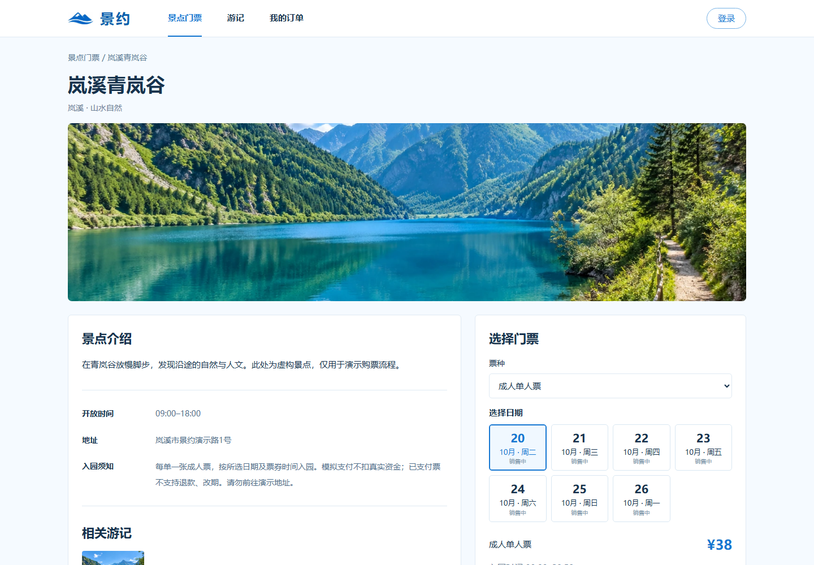
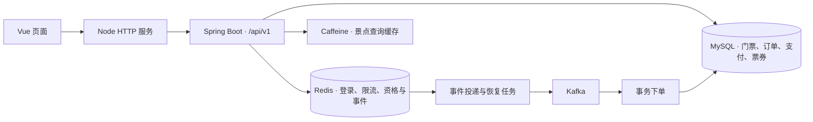

# 景约

一个 Vue + Spring Boot 文旅票务项目。浏览景点、选择日期、预约抢购、查询订单、模拟支付、领取电子票，再由授权核销员核销，配有独立运营台。

[功能](#功能) · [实现重点](#实现重点) · [架构](#架构) · [快速启动](#快速启动) · [项目教学](docs/项目教学.md)


## 功能

- **景点与日期门票**：按城市、分类、关键词筛选，查看景点介绍、入园须知和各日期余票。
- **购票与订单**：每次购买一张指定日期成人票；查询申请进度、待支付倒计时和历史订单，支持关闭未支付订单。
- **电子票与核销**：模拟支付后生成签名二维码；核销员只能核销授权景点的有效票券。
- **旅行游记**：发布、编辑自己的游记，上传图片，点赞与取消点赞。
- **运营台**：管理景点、票种和日期库存，预热、发布、暂停、结束与归档批次，查看异常、库存对账和操作审计。

支付与票券用于演示，不收取真实资金；景点、账号和售票活动均为示例数据。



## 实现重点

- **并发购票与流量治理**：基于 Redis Lua 原子完成日期库存预扣、购买资格与请求身份校验，通过 Kafka 异步下单；结合全局、SKU、用户三级滑动窗口限流及消息积压背压，控制峰值受理速率，降低数据库瞬时写入压力。
- **可靠消息与幂等落库**：设计 Redis 事件日志与 Stream 投递链路，采用 broker ACK 后清理、数据库事务提交后确认消费的机制；结合请求结果表、唯一约束、批量写入及异常隔离重试，处理请求重试和消息重放，避免重复扣库与重复建单。
- **关单与库存一致性**：通过本地事务同步关闭订单、归还数据库库存并写入 Outbox，异步恢复 Redis 库存；基于原订单身份、库存批次与永久去重记录实现幂等归还，处理取消后重购及旧归还消息重放导致的资格冲突。
- **多级缓存与并发重建**：构建 Caffeine + Redis 两级景点缓存，使用 Redisson 锁合并跨实例重建、版本校验阻止旧值回填；结合数据库失效待办、Pub/Sub 广播与 TTL 兜底，处理更新失败及本地缓存失效遗漏。
- **异步点赞与分表投影**：基于 Redis Lua 接收明确的点赞目标状态，通过 Stream 驱动批量事务落库；按游记 ID 路由至单库 16 张状态表，使用递增版本与取消点赞记录处理重复、乱序事件，维护点赞关系与计数一致性。
- **票务状态机与授权核销**：实现待支付、已支付、已使用、已关闭及已过期状态流转，通过统一加锁顺序与唯一约束协调模拟支付、取消和核销竞争；采用随机凭证与 HMAC-SHA256 签名生成电子票，结合角色、景点权限及有效期校验防止越权与重复核销。

## 架构



| 部分 | 技术 |
| --- | --- |
| 前端 | Vue 2、原生 CSS、Node.js HTTP 代理，依赖随源码提供 |
| 后端 | Java、Spring Boot、JDBC / Spring 事务 |
| 数据 | MySQL、Redis Hash / Stream、Lua、Caffeine、Redisson |
| 消息 | Kafka，批量消费、确认投递、失败隔离与重试 |

```text
backend/       Spring Boot 后端、SQL、Lua 与集成测试
frontend/      Vue 页面、代理服务、图片和第三方依赖
scripts/       初始化、启动、演示数据与验证脚本
docs/          教程、交易设计、部署说明和产品文档
```

## 快速启动

推荐 Node.js 20+、Docker Engine 和 Docker Compose v2。

```bash
git clone https://github.com/khanvhujil-byte/jingyue.git
cd jingyue
node scripts/init-compose-env.mjs
docker compose up -d --build
```

等待 <http://127.0.0.1:5190/api/v1/health> 返回正常，再初始化演示票种的销售状态：

```bash
node scripts/prepare-demo.mjs
```

打开 **<http://127.0.0.1:5190/#/>**。前端直接运行 Vue 文件，不需要 `npm install` 或前端打包。初始化脚本为当前机器生成 `.env`；再次执行会保留原密码和票券签名密钥。

登录框选择演示身份，点击“获取验证码”后登录，无需短信服务：

| 账号 | 身份 |
| --- | --- |
| `13900000001` | 普通用户 |
| `13900000002` | 运营管理员 |
| `13900000003` | 岚溪青岚谷核销员 |
| `13900000004` | 栖川云水古镇核销员 |

MySQL、Redis、Kafka 和上传目录使用独立数据卷。原生启动、环境变量和服务器代理配置见[部署说明](docs/部署说明.md)。

## 阅读源码

[《项目教学》](docs/项目教学.md)从一次选票请求开始，分章讲解日期库存、登录、Lua 受理、消息投递、事务下单、支付核销、缓存和点赞。接口清单见[交易设计与接口](docs/交易设计与接口.md)，产品范围见 [PRD V1.0](docs/PRD-V1.0.md)。

```bash
# 编译后端及测试源码，生成可运行 JAR
mvn -B -f backend/pom.xml -DskipTests package

# 检查前端脚本语法
node --check frontend/app.js
node --check frontend/server.mjs
```

`TicketIntegrationTest` 会写入数据库和 Redis，仅在独立测试环境运行。GitHub Actions 为它创建独立 MySQL、Redis 和 Kafka，不复用开发机的数据。

## 来源

景约从[黑马点评学习项目](https://gitee.com/yueruf/yueruf-hmdp)的缓存、限流和异步互动链路扩展为独立票务工程，部分复用代码保留 `com.hmdp` 包名与原作者注释。Vue 与二维码库的授权文件位于 [frontend/vendor](frontend/vendor)。
