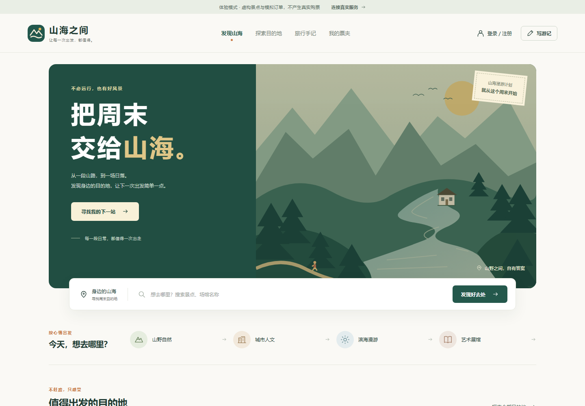
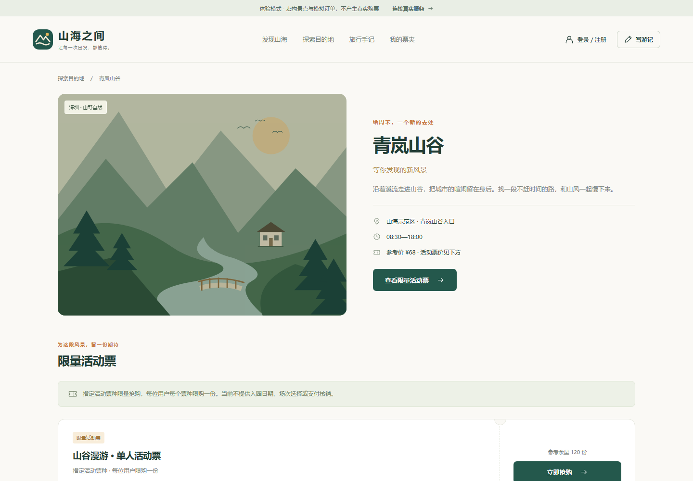
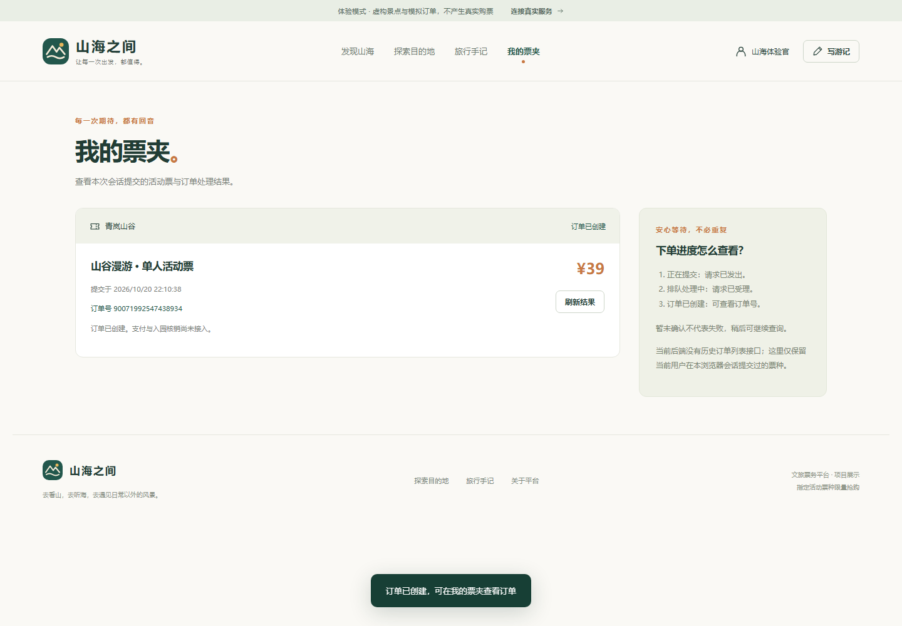
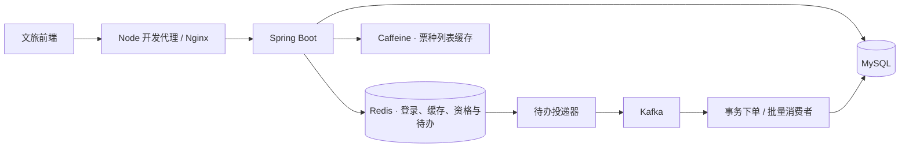

# 山海之间 · hm-dianping

一个可以浏览目的地、写旅行手记、参与限量活动票抢购的文旅应用。后端基于黑马点评学习项目扩展，重点实现秒杀受理、可靠消息投递、事务下单和并发点赞；前端提供可直接体验的页面。

[功能](#能做什么) · [设计](#几个实现重点) · [架构](#架构) · [运行](#本地运行) · [Docker](#docker-运行完整项目) · [项目教学](docs/项目教学.md)



## 能做什么

- **发现目的地**：按分类浏览、搜索景点与场馆，查看详情和活动票种。
- **限量抢购**：校验库存与购买资格，异步创建订单，页面区分处理中和订单已创建。
- **旅行手记**：发布文字记录，点赞、取消点赞、关注旅人并查看关注动态。
- **旅人账号**：手机号验证码登录、登录态续期、个人手记与签到。
- **两种体验方式**：页面内可切换内置体验数据和真实后端；默认即可体验搜索、登录、抢购和互动。



## 几个实现重点

**先受理，再落库。** Redis Lua 在一次执行中检查库存与一人一单，保存预扣和待发送事件。后台将事件投递到 Kafka，收到发送确认后删除 Redis 待办，失败则保留重试。

**重复消息也要能处理。** 消费者在数据库事务内锁定库存、检查订单、扣库存并写订单，提交后确认消费；订单主键和用户—票种唯一约束作为数据库边界。

**预扣过程可以恢复。** Lua 写入前检查键类型，使用恢复记录区分需要撤回的预扣与需要继续投递的订单，避免把脚本报错直接当成已回滚。

**点赞支持两条路径。** 默认事务更新点赞关系和计数；可选异步模式由 Redis 接收状态变化，按笔记路由到 16 张状态表，使用版本处理重放和乱序，再批量投影到 MySQL。

**请求结果不确定时先查询。** 前端保存已发起的购买操作，刷新后查询状态，保留 Java Long 订单号精度。限流使用 Redis 时间与递增序号，防止同毫秒请求覆盖计数。



以上截图来自实际页面的内置体验数据。真实模式连接自己的后端，订单链路覆盖到订单创建。

## 架构



| 部分 | 技术 | 职责 |
| --- | --- | --- |
| 后端 | Java、Spring Boot、MyBatis-Plus | 登录、目的地、手记、抢购与订单状态 |
| 数据与缓存 | MySQL、Redis、Lua、Caffeine | 业务存储、登录态、库存资格、缓存与限流 |
| 异步处理 | Redis Stream、Kafka、Spring 事务 | 事件保留、确认投递、消费与幂等落库 |
| 前端 | JavaScript ES Modules、CSS、Node.js | 页面、真实接口适配、体验数据与静态构建 |

## 本地运行

推荐 **JDK 17、Maven 3.9、Node.js 20+**。完整后端需要 MySQL 8、Redis 7 和 Kafka。

```bash
git clone https://github.com/khanvhujil-byte/hm-dianping.git
cd hm-dianping
```

### 先体验页面

```bash
cd frontend
npm run dev
```

打开 <http://127.0.0.1:5173>。无需安装前端依赖；体验模式可使用合法格式手机号，验证码为 `123456`，数据保存在当前浏览器会话中。

### 连接真实后端

1. 在独立 MySQL 开发库导入 [hmdp.sql](src/main/resources/db/hmdp.sql)。脚本创建 `shanhai_ticket`，包含表结构和虚构文旅数据。
2. 启动 Redis 与 Kafka，通过环境变量配置连接。示例见 [部署说明](docs/部署说明.md)。
3. 在项目根目录启动应用：

```bash
mvn spring-boot:run
```

应用默认监听 `8081`。首次初始化活动票种，在项目根目录执行：

```bash
node frontend/scripts/seed-tickets.mjs
```

然后在页面点击“连接真实服务”。前端服务器默认将 `/api` 转发到本机 `8081`。开发验证码可从应用日志查看。

## Docker 运行完整项目

将根目录 `.env.example` 复制为 `.env`，为 `MYSQL_ROOT_PASSWORD` 和 `MYSQL_APP_PASSWORD` 填写两个不同的密码。根目录执行：

```bash
docker compose config --quiet
docker compose up -d --build
```

打开 <http://127.0.0.1:8080>，等待 `http://127.0.0.1:8080/api/shop-type/list` 返回分类，再初始化活动票：

```bash
docker compose --profile tools run --rm seed
```

在页面切换到真实服务即可使用。MySQL、Redis、Kafka 和上传目录使用持久化卷；入口绑定本机 `8080`。服务器域名代理与更新方式见[部署说明](docs/部署说明.md)。

## 阅读与验证

[《项目教学》](docs/项目教学.md)从一次请求开始，逐章讲解登录、缓存、秒杀、消息可靠性、事务、点赞、限流和前端状态。

后端订单与点赞测试会使用隔离 Redis、内嵌 Kafka 和 H2；需要将 `redis-server` 加入 PATH，或通过系统属性指定可执行文件：

```bash
mvn -Dtest="com.hmdp.order.*Test,com.hmdp.like.*Test" test
mvn -DskipTests package
```

前端目录运行 `npm test` 和 `npm run build`。详细测试入口见[教程第十章](docs/项目教学.md#第十章验证与构建)。

## 来源

后端基于[黑马点评学习项目](https://gitee.com/yueruf/yueruf-hmdp)，保留 `com.hmdp` 包名与原有作者注释。本仓库整理了当前扩展代码、文旅前端和虚构示例数据。第三方源码与素材遵循各自授权。
